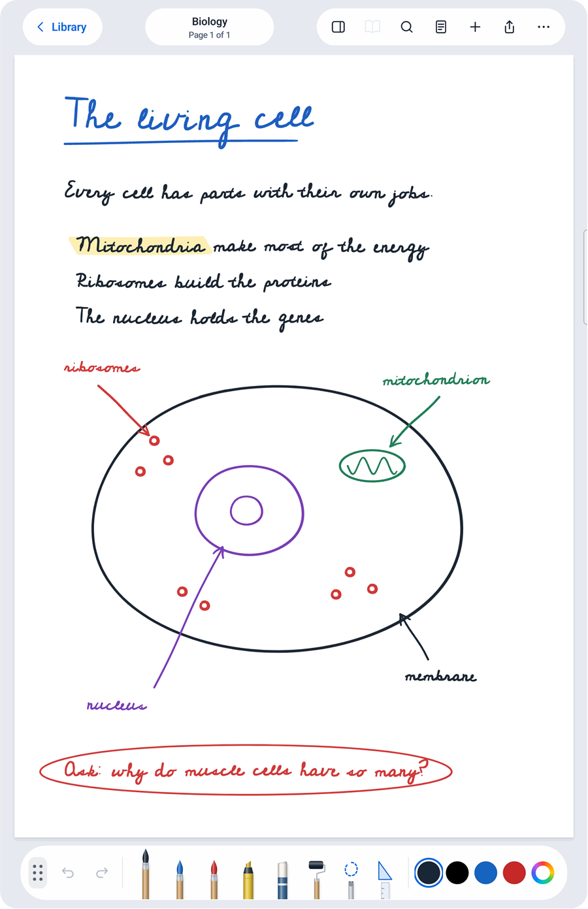
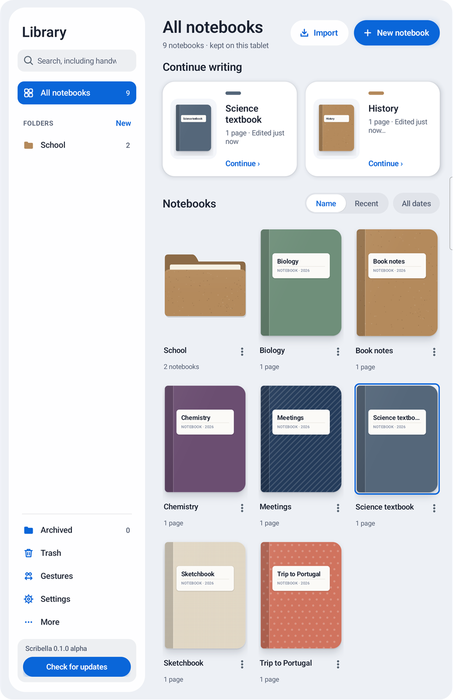
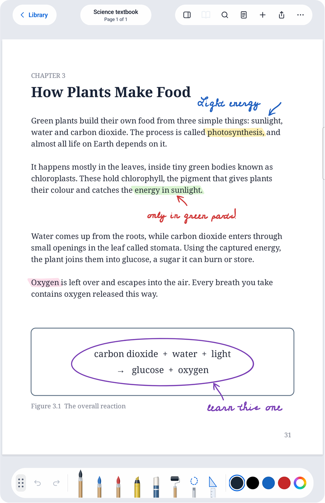
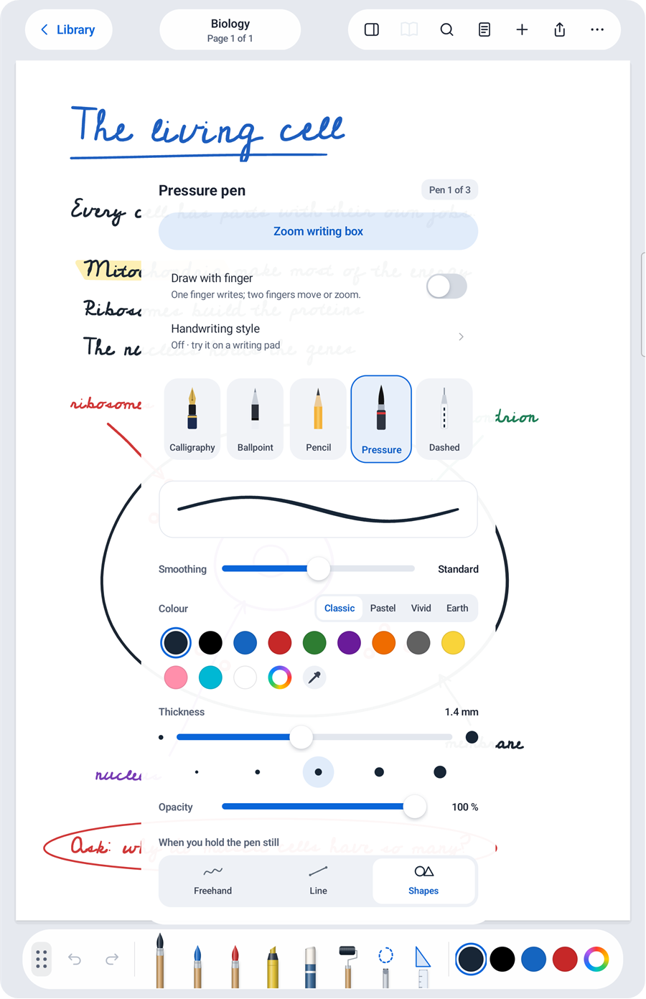
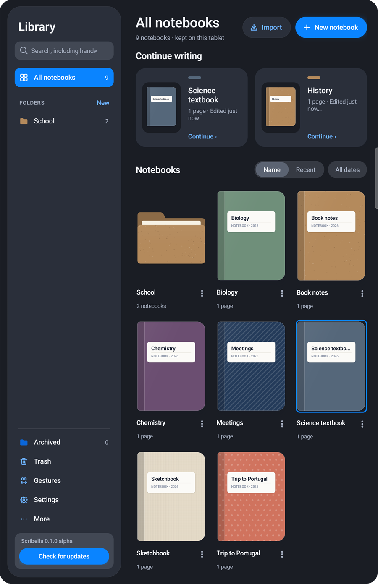
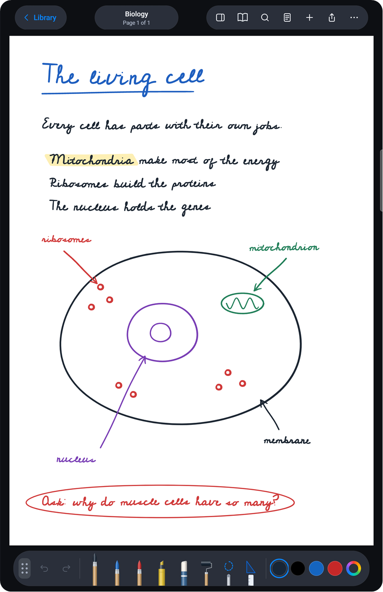
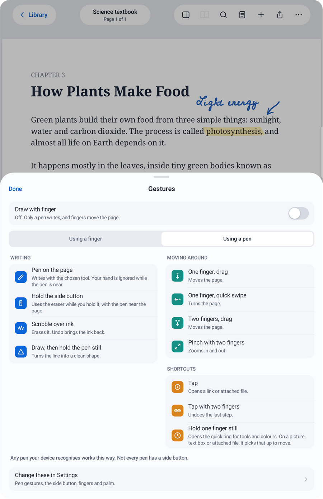

<p align="center">
  
</p>

<h1 align="center">Scribella</h1>

<p align="center">
  A free handwriting notebook for Android.<br>
  No account, no advertising, no subscription. Your notes stay on your device.
</p>

<p align="center">
  <strong><a href="../../releases">Download the alpha</a></strong> &nbsp;·&nbsp;
  <a href="../../issues/new">Report a bug</a> &nbsp;·&nbsp;
  <a href="PRIVACY.md">Privacy</a>
</p>

<p align="center">
  
  
</p>

> **This is an alpha.** It works, but expect rough edges. It has only been tested on one Samsung tablet with an S Pen so far. Export your notebooks now and then so you always have a copy, and please [report what breaks](#found-a-bug).

## What it does

- **Write and draw** with calligraphy, ballpoint, pencil, pressure and dashed pens, plus highlighter, eraser and lasso. Draw a line, hold the pen still, and it becomes a clean shape.
- **Mark up PDFs**, and bring in Office files as PDF pages.
- **Scan paper** with the camera.
- **Search your handwriting** from the library, and read it into text.
- **Record audio** into a notebook.
- **Sync or back up** through a folder or a WebDAV server you choose.
- **Keep things tidy** with folders and covers, and lock the app if you like.
- **Dark mode** follows your device.

<p align="center">
  
  
</p>

<p align="center">
  
  
</p>

## Install

You need Android 13 or newer on an ARM phone or tablet. Scribella is not on Google Play.

1. Open the [Releases page](../../releases) on your device and download the newest `Scribella-….apk`.
2. Open the file. Android asks you to allow installs from your browser or file app the first time, and Play Protect may warn you about an app it hasn't seen before.
3. To check your download is genuine, compare its SHA-256 with the one listed on the release.

Only install copies from this page. Later versions install over this one and keep your notebooks, as long as they come from here.

## Found a bug?

[Open an issue](../../issues/new). It needs a free GitHub account. It helps most if you include:

- your device, and your Android version
- your Scribella version (it's at the bottom of the library's side panel)
- what you did, what you expected, and what happened instead
- a screenshot, if it shows the problem

Please don't post anything private, and check a screenshot before you attach it. Scribella doesn't send crash reports, so a bug only gets known when someone writes it here.

## Pens and fingers

Scribella was made for a tablet and an S Pen, and it also works with fingers and other pens. The app has a guide to all of this: **Gestures** in the library's side panel.

- **No pen:** one finger writes. Two fingers move and zoom the page, or swipe to turn it. Tap a link to open it, and hold a finger still for the quick tools.
- **A stylus Android recognises** (S Pen, USI and similar): the first time it touches or hovers over the app, Scribella switches to it. The pen writes, one finger moves the page, and pressure and a side button work if the pen has them.
- **A simple rubber-tip pen:** Android sees it as a finger, so it writes like one, with an even line. Keep your hand off the glass, because Android can't tell a resting hand from the tip.

Either way, "Draw with finger" in the pen's menu lets you choose for yourself, and your choice stays.

<p align="center">
  
</p>

## Updates

Tap **Check for updates** at the bottom of the library's side panel. If there is a new version, it opens the download page in your browser. The app never checks by itself, and never installs anything by itself.

Version numbers: `0.1.1` is a small fix, `0.2.0` has new features. Everything stays marked alpha for now.

## Licence

Scribella is free. It uses the [PolyForm Noncommercial License 1.0.0](https://polyformproject.org/licenses/noncommercial/1.0.0). The licence itself is what counts; in short:

- **You can** use it, study it, change it, improve it and share it, for any noncommercial purpose. Schools, charities and public research organisations can use it too.
- **You can't** make money from it: no selling it or a version of it, and no building it into something paid.
- **If you share it**, changed or not, pass on these terms and the `Required Notice` line in [LICENSE](LICENSE).

Want to use it in a way the licence doesn't allow? Ask first by opening an issue.

The author's promise: Scribella stays free, with no paid version and no advertising.

The libraries and fonts the app uses keep their own licences. See [the notices](app/src/main/assets/licenses/THIRD-PARTY-NOTICES.txt), or in the app, Settings → Privacy & storage → Licences and notices. The text recognition libraries are Google's own, under [Google's ML Kit terms](https://developers.google.com/ml-kit/terms), and aren't covered by this project's licence.

## Privacy

Your notebooks stay on your device unless you export, sync or back them up. The one thing that goes to someone else without you asking is usage figures from Google's text recognition library. [PRIVACY.md](PRIVACY.md) has the details.

## Build it yourself

You need JDK 17 and the Android SDK.

```bash
./gradlew :app:assembleDebug
```

`./gradlew :app:assembleRelease` makes an unsigned release APK. To sign it, set the environment variables `SCRIBELLA_KEYSTORE` and `SCRIBELLA_KEYSTORE_PASSWORD` to your own key. The code comments mention internal work numbers such as `P563`; they can be ignored.

## Other apps

Scribella is an independent project and isn't connected with any other note app or device maker. Samsung and S Pen are trademarks of their owners.

Scribella was built by one person working with AI coding assistants. A few internal labels in the code still carry its earlier working name, because changing them would stop existing keys and data from opening. None of them appears on screen.

The app comes as is, without any warranty. The licence has the full wording.
